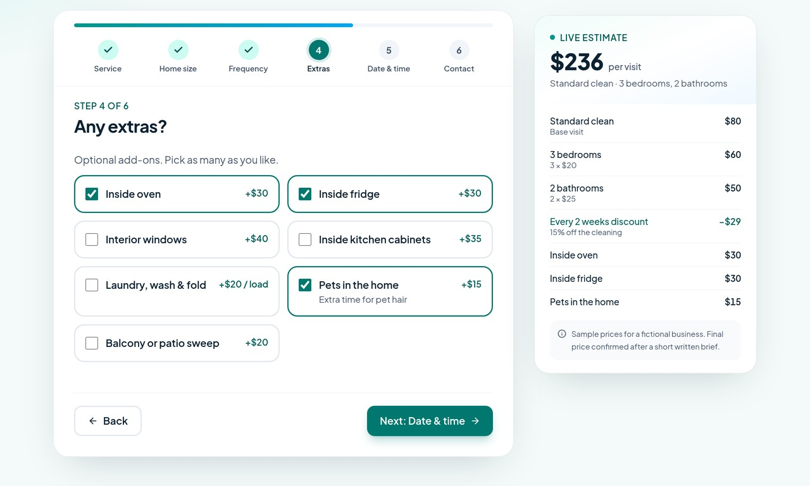
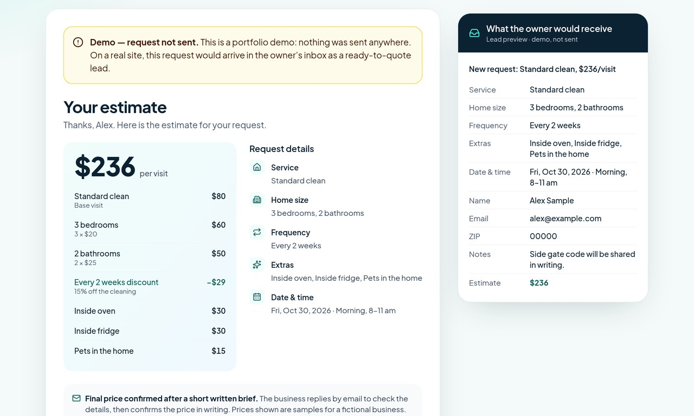

# Instant Cleaning Price Calculator — portfolio demo

Demo website by Ivan Litvin · fictional business, sample prices.

"Mintleaf Home Cleaning" is a **fictional** company. All prices are **sample prices**.
The request form **sends no data anywhere**: there is no backend, the inputs have no `name` attributes, the form has no action, and on submit the site shows "Demo — request not sent".

**Live demo:** https://quote-calculator-demo.pages.dev




## What it does
- A 6-step quote flow with a progress indicator: service → home size (rooms or sq ft) → frequency (with discount) → extras → date and arrival window → contact.
- A live itemized estimate: a sticky sidebar on desktop and a bottom bar with an expandable breakdown on mobile.
- A summary screen with "Your estimate", the breakdown, the request details, and a preview of the lead the owner would receive. The final price is confirmed after a short written brief.
- Validation, full keyboard support, visible focus states, and quote choices saved in localStorage. Contact details are never stored.

## Stack
Vite 8, React 19, TypeScript 6, Tailwind CSS 4, lucide-react icons, and Plus Jakarta Sans (self-hosted).
The page is prerendered to static HTML at build time and then hydrated, with CSS inlined.

## Prices: one file
Every price and rule lives in **`src/pricing.ts`**. It holds:
- base price per service, per bedroom, per bathroom and per sq ft
- frequency discounts
- extras, including per-unit extras with a max quantity
- the weekend surcharge, minimum visit price, time windows, booking window and currency

The formula is documented at the top of the file. Edit the numbers and rebuild. The "Sample prices" table on the site is generated from the same file.

## Commands
```bash
npm ci
npm run dev               # local dev server
npm run build             # type-check, build, prerender -> dist/
npm run preview           # serve dist/ at http://127.0.0.1:8796
npm run test:e2e          # Playwright end-to-end: price math vs config, no data sent
npm run test:a11y         # axe on every step, desktop + mobile
npm run test:lighthouse   # Lighthouse mobile + desktop -> reports/
```
The test scripts use Playwright, axe-core and Lighthouse from local paths on the build machine. Adjust the imports at the top of `tests/*.mjs` if you run them elsewhere.

## Deploy (Cloudflare Pages, static)
Build, then deploy the `dist/` folder:
```bash
npm ci && npm run build
npx wrangler pages deploy dist --project-name quote-calculator-demo
```
If you connect the GitHub repo in the Cloudflare Pages dashboard instead, use build command `npm run build`, output directory `dist`, and set `NODE_VERSION=22`.
`_headers` (security headers and CSP), `robots.txt` and `sitemap.xml` are generated by `scripts/postbuild.mjs`. If you use a different domain, set `SITE_URL` when building.

## License
[MIT](LICENSE) © 2026 Ivan Litvin
